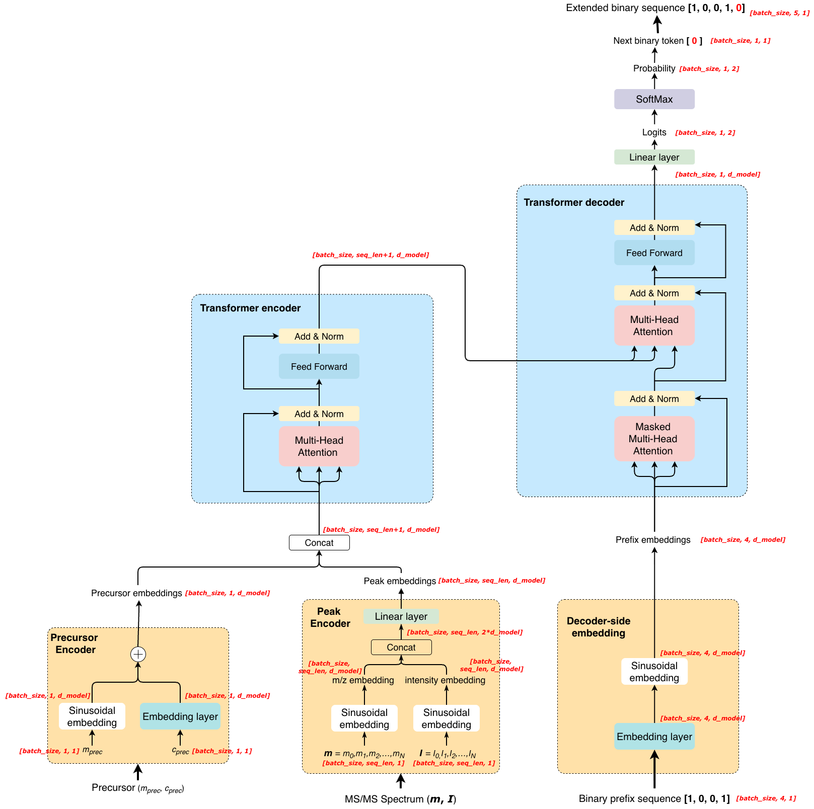

# A Transformer-Based Model for Noise-Peak Identification in MS/MS Spectra

## 1. Project overview
LC-MS/MS is widely used for peptide identification and de novo peptide sequencing. However, MS/MS spectra typically contain numerous noise peaks that may affect fragment ion identification and downstream peptide sequencing.      

**In this study, a Transformer-based model was developed to identify noise peaks in MS/MS spectra.**    

First, peak-level binary ground-truth labels were generated for the experimental MS/MS spectra. Theoretical fragment ions were generated from the peptide sequence associated with each spectrum, and experimental peaks were labeled as fragment ion peaks or noise peaks based on m/z matching. The peak m/z, intensity, and precursor information were then provided as input to a Transformer encoder-decoder model, which predicted a binary label for each peak. Model performance was evaluated using recall and precision.      

**This README describes the complete workflow used for data preprocessing, model training, validation, testing, and result visualization.**    

## 2. Repository structure

The main files and directories in the repository are organized as follows:    

```text
.
├── Documents
│
├── Environment
│   ├── model_training_env_2026_08_29.yml
│   └── data_preprocessing_env_2026_08_29.yml
│
├── Detroit562
│   ├── mgf_folder
│   │   └── DT_M2106_048.mgf
│   ├── DT_M2106_046.csv
│   └── csv_file.txt
│
├── Dataloader
│   └── Dataloader_24_06_24.py
│
├── TransformerBlock
│   ├── Encoder_24_07_05.py
│   ├── Decoder_25_12_08.py
│   └── PositionalEncoding_24_07_02.py
│
├── Preprocessing
│   ├── combine_mgf_and_percolator.py
│   ├── 2026_04_07_calculate_ion_mass.py
│   ├── Theoretical_fragment_ion_2026_04_07.sh
│   ├── Combine_mgf_csv.sh
│   ├── 2026_03_10_adding_label.py
│   ├── adding_label_2026_04_07.sh
│   ├── 2016_05_03_making_dataset.py
│   ├── making_tensor_dataset_2026_04_07.sh
│   ├── Split_dataset_2026_04_07.py
│   ├── Looking_at_whole_dataset.py
│   ├── 2026_04_10_test_dataset_explore.py
│   ├── 2026_04_10_train_dataset_explore.py
│   └── 2026_04_10_valid_dataset_explore.py
│
├── TrainingModel_2026_04_10
│   ├── 2026_04_10_result_analysis.py
│   └── ...
│
├── TrainingModel_2026_06_26
│   ├── Result_analysis_2026_06_26_now.py
│   └── ...
│
├── Test_2026_04_09
│   ├── Result_analysis_test_2026_04_09.py
│   └── ...
│
├── Trian_with_new_decoder_26_04_10.sh
├── TrainingModel_2026_04_10.py
├── config_2026_04_10.yaml
├── Trian_with_new_decoder_26_06_26.sh
├── TrainingModel_2026_06_26.py
├── config_2026_06_26.yaml
├── Test_2026_04_09.py
└── README.md
```

**Directory description**  
- `Environment/`: Conda environment configuration files.
- `Detroit562/`: Example/original input data containing paired spectrum and identification files.
- `Dataloader/`: Dataset loading utilities used for model training and evaluation.
- `TransformerBlock/`: Transformer encoder, decoder, and positional encoding implementations.
- `Preprocessing/`: Scripts for data preprocessing, label generation, dataset construction, splitting, and data exploration.
- `TrainingModel_2026_04_10/`: Stage-1 training result analysis and generated outputs.
- `TrainingModel_2026_06_26/`: Stage-2 training result analysis and generated outputs.
- `Test_2026_04_09/`: Test-set evaluation results and result-analysis script.


## 3. Software requirements
Two separate Conda environments were used in this project: one for data preprocessing and one for model training and evaluation.     
### 3.1 Data preprocessing environment     
The data preprocessing scripts were run using the following main software and packages:     

| Software / Package | Version |
|---|---:|
| Python | 3.12.8 |
| PyTorch | 2.5.1 |
| NumPy | 2.2.2 |
| pandas | 2.2.3 |
| Matplotlib | 3.9.4 |
| Pyteomics | 4.7.5 |
| scikit-learn | 1.5.2 |

The complete Conda environment is provided in:

```bash
data_preprocessing_env_2026_08_29.yml
````

The environment can be recreated using:

```bash
conda env create -f Environment/data_preprocessing_env_2026_08_29.yml -n preprocessing_env
conda activate preprocessing_env
```

---

### 3.2 Model training environment

The model training, validation, and testing scripts were run using the following main software and packages:

| Software / Package |      Version |
| ------------------ | -----------: |
| Python             |       3.13.7 |
| PyTorch            |        2.8.0 |
| NumPy              |        2.1.2 |
| pandas             |        3.0.1 |
| Matplotlib         |       3.10.6 |
| scikit-learn       |        1.9.0 |
| torchvision        | 0.23.0+cu126 |
| CUDA               |         12.6 |

The PyTorch installation used CUDA 12.6:

```text
torch 2.8.0+cu126
```

The complete Conda environment is provided in:

```bash
model_training_env_2026_08_29.yml
```

The environment can be recreated using:

```bash
conda env create -f Environment/model_training_env_2026_08_29.yml -n train_env
conda activate train_env
```

---

### 3.3 Hardware

Most data preprocessing, model training, validation, and testing tasks were run on the LUNARC HPC cluster using SLURM. LUNARC is the high-performance computing infrastructure at Lund University.

The corresponding SLURM job scripts are included in this repository and can be used to reproduce the computational workflow on a SLURM-based HPC system.

Model training and evaluation were performed on a LUNARC GPU node with the following configuration:

| Hardware     | Specification         |
| ------------ | --------------------- |
| GPU          | NVIDIA A100 80GB PCIe |
| GPU memory   | 80 GB                 |
| CUDA version | 12.6                  |


## 4. Input data

The original data consist of paired TSV and MGF files that share the same ID number, named {ID_number}.tsv and {ID_number}.mgf, respectively. The TSV file contains peptide identification information, while the corresponding MGF file contains the experimental MS/MS spectra.

### 4.1 TSV file

The TSV files are located in:

`Detroit562/`

The following fields are required:

- `TITLE`: Spectrum identifier used to match the spectrum with the corresponding entry in the MGF file.
- `DenovoPeptideSequence`: Peptide sequence associated with the MS/MS spectrum.
- `SpectrumScore`: Score associated with the identified spectrum.

### 4.2 MGF file

The corresponding MGF files are located in:

`Detroit562/mgf_folder/`

Each spectrum contains the following information:

- `TITLE`: Spectrum identifier.
- `SCANS`: Scan identifier.
- `PEPMASS`: Precursor m/z.
- `CHARGE`: Precursor charge state.
- `RTINSECONDS`: Retention time in seconds.
- Peak list: Experimental peak m/z and intensity values.

## 5. Workflow

Detailed instructions for each step are provided below.

Before running the workflow, navigate to the project root directory. 

``` bash
cd /path/to/project
```  

All commands in this section are assumed to be executed from the project root directory. Therefore, `./` refers to the current directory, which is the project root directory in this workflow.   

### Before 5.1: Activate the data preprocessing Conda environment

Steps 5.1-5.4 use the Conda environment defined in `data_preprocessing_env_2026_08_29.yml`.    

The environment can be recreated using:
```bash
conda env create -f data_preprocessing_env_2026_08_29.yml -n preprocessing_env
```

Activate the environment using:   
```bash
conda activate preprocessing_env
```

### 5.1: Combine MGF and TSV files

**Script:** `Preprocessing/combine_mgf_and_percolator.py`

**Input:**
- MS/MS spectrum file: `{ID_number}.mgf`
- Percolator result file: `{ID_number}.tsv`

**Output:**
- Combined data file: `~/Preprocessing_output/{ID_number}_before_annotation.pkl`

Run the preprocessing script using:
```bash
bash Preprocessing/Combine_mgf_csv.sh > Preprocessing/Combine_mgf_csv.txt
```

### 5.2: Calculate theoretical fragment ion masses

**Script:** `Preprocessing/2026_04_07_calculate_ion_mass.py`

**Input:**
- Combined data file:  `~/Preprocessing_output/{ID_number}_before_annotation.pkl`

**Output:**
- Processed data file: `~/Preprocessing_output/preprocessing_output_2026_04_07/{ID_number}_before_comparing.pkl`

Run the preprocessing script using:

```bash
bash Preprocessing/Theoretical_fragment_ion_2026_04_07.sh > Prepocessing/Theoretical_fragment_ion_2026_04_07.txt
```
### 5.3: Generate binary peak labels
Binary labels were assigned by matching experimental peaks against theoretical fragment ions using the specified m/z tolerance.

**Script:** `Preprocessing/2026_03_10_adding_label.py`

**Input:**
- Processed data file: `~/Preprocessing_output/preprocessing_output_2026_04_07/{ID_number}_before_comparing.pkl`

**Output:**
- Labeled data file: `~/Preprocessing_output/preprocessing_output_2026_04_07/{ID_number}_label_added.pkl`

Run the preprocessing script using:

```bash
bash Preprocessing/adding_label_2026_04_07.sh > Preprocessing/Adding_Label_2026_04_07.txt
```

### 5.4: Convert peak data to tensor format
The peak m/z values, intensities, binary labels, and precursor information are converted into tensor format for subsequent model training and evaluation.

**Script:** `Preprocessing/2016_05_03_making_dataset.py`

**Input:**
- Labeled data file: `~/Preprocessing_output/preprocessing_output_2026_04_07/{ID_number}_label_added.pkl`

**Output:**
- Tensor-formatted data file: `~/Preprocessing_output/preprocessing_output_2026_04_07/{ID_number}_tensor_dataset.pkl`

Run the preprocessing script using:

```bash
bash Preprocessing/making_tensor_dataset_2026_04_07.sh > Preprocessing/making_tensor_dataset_2026_04_07.txt
```

### Before Step 5.5: Activate the model training Conda environment

Starting from Step 5.5, use the Conda environment defined in `model_training_env_2026_08_29.yml`.

The environment can be recreated using:
```bash
conda env create -f model_training_env_2026_08_29.yml -n train_env
```

Activate the environment using:   
```bash
conda activate train_env
```

### 5.5 Combine datasets, perform data exploration, and split the dataset

This step performs the following tasks: 
- Combine the tensor dataset files from different `{ID_number}` datasets to create the original dataset. 
- Explore the distributions of the original dataset. 
- Compare the high-score group and the low-score group. 
- Split the dataset into the training set (80%), validation set (15%), and test set (5%).

**Script:** `Preprocessing/Split_dataset_2026_04_07.py`

**Input:**
- Tensor-formatted data file: `~/Preprocessing_output/preprocessing_output_2026_04_07/{ID_number}_tensor_dataset.pkl`

**Output:**
- Train-set: `~/Preprocessing_output/preprocessing_output_2026_04_07/2026_04_10_train_dataset.pkl`
- Validation-set: `~/Preprocessing_output/preprocessing_output_2026_04_07/2026_04_10_valid_dataset.pkl`
- Test-set: `~/Preprocessing_output/preprocessing_output_2026_04_07/2026_04_10_test_dataset.pkl`

Run the preprocessing script using:

```bash
python ~/Preprocessing/Split_dataset_2026_04_07.py
```

### Before Step 5.6: Copy the datasets to the project root directory

Copy the training, validation, and test datasets to the project root directory:

- `2026_04_10_train_dataset.pkl`
- `2026_04_10_valid_dataset.pkl`
- `2026_04_10_test_dataset.pkl`

Run:

```bash
cp ~/Preprocessing_output/preprocessing_output_2026_04_07/2026_04_10_*_dataset.pkl ./
```

### 5.6 Stage-1 training

In Stage 1, the model is trained from scratch.

**Script:** `TrainingModel_2026_04_10.py`  
**SLURM job script:** `Train_with_new_decoder_26_04_10.sh`   

**Input:**  
- Training dataset: `2026_04_10_train_dataset.pkl`
- Validation dataset: `2026_04_10_valid_dataset.pkl`
- Configuration file: `config_2026_04_10.yaml`

**Output:**

The output files are saved in:

`TrainingModel_2026_04_10/`

Six files are generated for each epoch. For example, for Epoch 10, the following files are generated:

- `Epoch:10_Precision-Recall.png`
- `Epoch:10_Precision_Heatmap.png`
- `Epoch:10_Precision_Recall_DataFrame.tsv`
- `Epoch:10_Recall_Heatmap.png`
- `checkpoint_epoch10.pth`
- `loss_curve_Epoch10.png`

Run the Stage-1 training job using:    
```bash
sbatch Train_with_new_decoder_26_04_10.sh
```

### 5.7 Stage-2 training

In Stage 2, training is continued from the Stage-1 checkpoint, `TrainingModel_2026_04_10/checkpoint_epoch19.pth`.

**Script:**: `TrainingModel_2026_06_26.py`
**SLURM job script:** `Trian_with_new_decoder_26_06_26.sh`   

**Input:**  
- Training dataset: `2026_04_10_train_dataset.pkl`
- Validation dataset: `2026_04_10_valid_dataset.pkl`
- Configuration file: `config_2026_06_26.yaml`
- Stage-1 checkpoint: `TrainingModel_2026_04_10/checkpoint_epoch19.pth`

**Output:**
The output files are saved in:
`TrainingModel_2026_06_26/`

Six files are generated for each epoch. For example, for Epoch 20, the following files are generated:

- `Epoch:20_Precision-Recall.png`
- `Epoch:20_Precision_Heatmap.png`
- `Epoch:20_Precision_Recall_DataFrame.tsv`
- `Epoch:20_Recall_Heatmap.png`
- `checkpoint_epoch20.pth`
- `loss_curve_Epoch20.png`

Run the Stage-2 training job using:    
```bash
sbatch Trian_with_new_decoder_26_06_26.sh
```

### 5.8 Test-set evaluation

The Stage-2 checkpoint from Epoch 24 was used to evaluate the model on the test set.

**Script**: `Test_2026_04_09.py`   
**Input**:
- Test dataset: `2026_04_10_test_dataset.pkl`
- Configuration file: `config_2026_06_26.yaml`
- Stage-2 checkpoint: `TrainingModel_2026_06_26/checkpoint_epoch24.pth`

**Output**: 
The output files are saved in:   
`Test_2026_04_09/`  

The output files include:
- `Test_step_Precision_Recall_DataFrame.tsv`
- `Test_set_heatmap.png`				
- `Test_set_precision_heatmap.png`	
- `Test_set_recall_heatmap.png`			
- `Test_set_seq_len_distribution.png`		
- `Test_set_label_1_proportion_distribution.png`	
- `Test_step_Precision-Recall.png`

Run the test-set evaluation using:  
```bash
python Test_2026_04_09.py 
```

The final test-set performance was:

- Mean recall: 0.508
- Mean precision: 0.426

### 5.9 Figure generation

#### 5.9.1 Data exploration figures

- Generate figures for the original dataset.

  Run:

  ```bash
  python Preprocessing/Looking_at_whole_dataset.py
  ```

* Generate figures for the training set.

  Run:

  ```bash
  python Preprocessing/2026_04_10_train_dataset_explore.py
  ```

* Generate figures for the validation set.

  Run:

  ```bash
  python Preprocessing/2026_04_10_valid_dataset_explore.py
  ```

* Generate figures for the test set.

  Run:

  ```bash
  python Preprocessing/2026_04_10_test_dataset_explore.py
  ```

#### 5.9.2 Model training and evaluation figures

* Generate figures for the Stage-1 training results.

  Run:

  ```bash
  python TrainingModel_2026_04_10/2026_04_10_result_analysis.py
  ```

* Generate figures for the Stage-2 training results.

  Run:

  ```bash
  python TrainingModel_2026_06_26/Result_analysis_2026_06_26_now.py
  ```

* Generate figures for the test-set evaluation results.

  Run:

  ```bash
  python Test_2026_04_09/Result_analysis_test_2026_04_09.py
  ```

## 6. Model architecture 
The detailed model architecture and description are shown in the image below. The changes in tensor shapes throughout the model are also annotated in the diagram.    

`batch_size`: The size of the mini-batch.   
`seq_len`: The length of the spectrum with the maximum peak count in this mini-batch.   
`d_model`: The dimension of the model.     

 

The model parameters are provided in Supplementary Table 1 of the report.

## 7. Expected results

The following results should be obtained when reproducing the workflow.

### Stage-1 training

For the selected Stage-1 checkpoint:

- Validation recall: 0.495
- Validation precision: 0.426

### Stage-2 training

For the selected Stage-2 checkpoint:

- Validation recall: 0.509
- Validation precision: 0.425

### Test-set evaluation

Using the final Stage-2 checkpoint:

- Mean recall: 0.508
- Mean precision: 0.426


## 8. Output files

The workflow generates preprocessed datasets, model checkpoints, evaluation results, and figures. The main output files are summarized below.

### 8.1 Preprocessed datasets

The preprocessed training, validation, and test datasets are generated during the data preprocessing workflow:

- `2026_04_10_train_dataset.pkl`
- `2026_04_10_valid_dataset.pkl`
- `2026_04_10_test_dataset.pkl`

These files are used as input for model training, validation, and test-set evaluation.

### 8.2 Model checkpoints

Model checkpoints are saved after each training epoch.

Stage-1 checkpoints are saved in:

`TrainingModel_2026_04_10/`

For example:

`TrainingModel_2026_04_10/checkpoint_epoch19.pth`

Stage-2 checkpoints are saved in:

`TrainingModel_2026_06_26/`

The final checkpoint used for test-set evaluation is:

`TrainingModel_2026_06_26/checkpoint_epoch24.pth`

### 8.3 Evaluation results and metrics

Validation results generated during model training include recall and precision values for individual spectra and summary statistics.

For each training epoch, the evaluation results are saved as TSV files, for example:

`Epoch:24_Precision_Recall_DataFrame.tsv`

The test-set evaluation results are saved in:

`Test_2026_04_09/`

The main test-set result file is:

`Test_2026_04_09/Test_step_Precision_Recall_DataFrame.tsv`

The final test-set performance is:

- Mean recall: 0.508
- Mean precision: 0.426

### 8.4 Figures

Figures generated during data exploration, model training, validation, and test-set evaluation include:

- Peak-count distribution plots
- Label-1 peak proportion distribution plots
- Recall and precision curves
- Recall heatmaps
- Precision heatmaps
- Training loss curves

Stage-1 training figures are saved in:

`TrainingModel_2026_04_10/`

Stage-2 training and validation figures are saved in:

`TrainingModel_2026_06_26/`

Test-set evaluation figures are saved in:

`Test_2026_04_09/`

Additional data exploration figures are generated by the scripts listed in Section 5.9.


